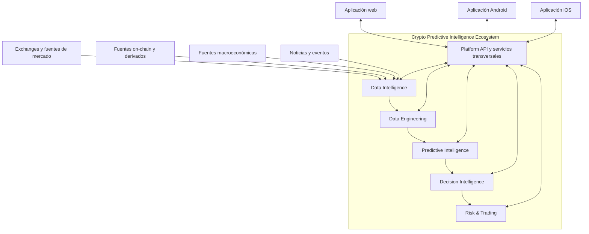
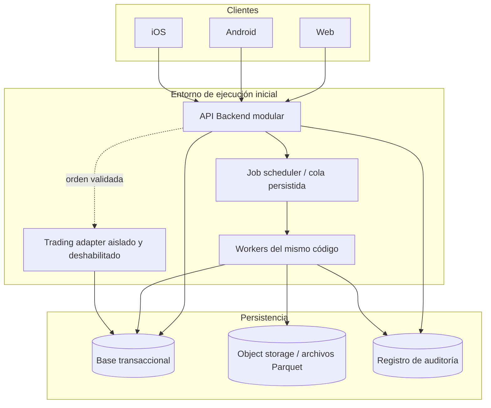
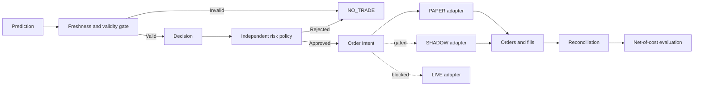

# Arquitectura de referencia de CPIE

- **Estado:** Arquitectura objetivo documentada; no implementada.
- **ADR:** [ADR-0001 — Arquitectura inicial modular](../adr/0001-modular-architecture.md)
- **Issue:** [#4 — Evaluar y definir la arquitectura modular](https://github.com/Osleyder1985/crypto-predictive-intelligence-ecosystem/issues/4)

## 1. Contexto del sistema

CPIE es una plataforma de inteligencia predictiva multiactivo con BTC como piloto. Su salida no es únicamente una predicción de precio: debe producir evaluaciones reproducibles, incertidumbre explícita y decisiones evaluables, incluyendo NO_TRADE. El trading real no forma parte del alcance habilitado inicialmente.

Las fuentes externas son no confiables hasta validar esquema, procedencia, licencia, temporalidad y calidad. Los clientes no conectan directamente con exchanges para ejecutar órdenes.

## 2. Vista de contenedores y procesos

El diagrama representa límites lógicos, no una selección tecnológica. #5 determinará motores, librerías y servicios tras comparación y POCs. Scheduler/cola persistida puede comenzar como mecanismo transaccional sencillo; no implica adoptar un broker distribuido.

## 3. Componentes y propiedad

| Módulo | Responsabilidad | Datos/contratos bajo su propiedad |
|---|---|---|
| Data Intelligence | Captura, adaptadores, procedencia y cobertura | Source, Capture, Raw Artifact, Market Observation, External Event |
| Data Engineering | Calidad, normalización, temporalidad y features | Quality Report, Dataset Snapshot, Feature Set |
| Predictive Intelligence | Investigación, entrenamiento, inferencia y evaluación | Experiment, Model Version, Prediction, Prediction Result |
| Decision Intelligence | Señales, ranking, cartera y abstención | Decision, Signal, Portfolio Proposal, NO_TRADE |
| Risk & Trading | Políticas, órdenes, fills, reconciliación y modos | Risk Assessment, Order Intent, Order, Fill, Execution Report |
| Platform/API | Identidad, autorización, orquestación, auditoría y API | API contracts, Access Policy, Audit Record |
| Clientes | Presentación e interacción | Estado local no autoritativo |

La persistencia física puede compartir inicialmente una base de datos, pero la propiedad lógica de cada conjunto de datos pertenece a un único módulo. No se permiten escrituras cruzadas directas.

## 4. Contratos principales

| Contrato | Campos conceptuales mínimos |
|---|---|
| Asset Registry | asset_id, canonical_symbol, network/chain cuando aplique, status |
| Instrument Registry | instrument_id, venue, market_type, base_asset, quote_asset, precision, trading_rules, effective_at |
| Market Observation | observation_id, instrument_id, source_id, event_time, available_at, ingested_at, recorded_at, value, unit, quality_status, provenance |
| External Event | event_id, source_id, event_type, occurred_at, published_at, available_at, ingested_at, revised_at, entities, evidence, confidence_basis |
| Dataset Snapshot | dataset_id, cutoff_time, source_snapshot_ids, transformation_version, row_manifest, quality_report_id |
| Feature Set | feature_set_id, entity_id, as_of_time, available_at, feature_schema_version, values, lineage |
| Prediction | prediction_id, asset/instrument, model_version, feature_set_id, generated_at, target_horizon, target_definition, estimate/distribution, uncertainty_status, validity_window |
| Decision / Signal | decision_id, prediction_ids, decision_time, horizon, validity, action, rationale, constraints, NO_TRADE_reason |
| Order Intent | intent_id, decision_id, mode, instrument_id, side, order_type, quantity/notional, limit, risk_check_id, idempotency_key, expires_at |
| Order / Fill | exchange_order_id, intent_id, status, timestamps, quantities, prices, fees, partial_fill details |
| Prediction Result | prediction_id, evaluation_cutoff, realized_target, evaluation_method_version, error/score, costs/context, immutable result |

Los esquemas concretos, tipos, unidades, nullability, claves, compatibilidad y reglas de evolución se especificarán antes de implementar cada contrato. Esta tabla no es todavía un schema ejecutable.

## 5. Temporalidad y reproducibilidad

Todos los datos relevantes distinguen:
- `event_time`: cuándo ocurrió el hecho en el dominio.
- `available_at`: cuándo la información estuvo disponible para el sistema/participante.
- `ingested_at`: cuándo fue recibida por CPIE.
- `recorded_at`: cuándo se registró en el almacenamiento de CPIE.

Las revisiones no sobrescriben silenciosamente el estado histórico: se conservan versiones y procedencia. Las consultas de entrenamiento/backtesting aplican un cutoff point-in-time sobre `available_at`, además del tiempo de evento. Una fecha de publicación retrospectiva o una revisión posterior no puede filtrarse en una decisión simulada anterior.

## 6. Flujos de datos

```mermaid
flowchart LR
    S[Source] --> C[Capture adapter]
    C --> R[Immutable raw]
    R --> V[Validation and normalization]
    V --> O[Observation / Event]
    O --> D[Dataset snapshot]
    D --> F[Feature set]
    F --> M[Prediction]
    M --> E[Prediction result]
    E --> L[Learning and monitoring]
```

## 7. Seguridad y límites de confianza

- Los clientes son zonas no confiables; toda autorización se valida en backend.
- Las fuentes externas se validan y no pueden inyectar instrucciones ejecutables en procesos internos.
- Los workers de investigación no reciben credenciales de exchange.
- El proceso de trading usa identidad y secretos de mínimo privilegio; claves sin permiso de retiro cuando el proveedor lo permita.
- Los modelos no acceden a secretos, no alteran límites y no llaman directamente a APIs de ejecución.
- Risk & Trading aplica controles deterministas antes de cualquier envío.
- Auditoría registra actor/servicio, decisión, versión de política, resultado y correlación de operación; nunca registra secretos.
- LIVE permanece bloqueado hasta un gate independiente y autorización explícita.

El threat model detallado y los controles se desarrollan en #7 después de la arquitectura y la selección tecnológica.

## 8. Reglas de dependencias

1. Clientes → API/contracts; nunca clientes → base de datos ni exchange privado.
2. API → interfaces de dominio; evitar lógica de dominio en controladores.
3. Dominio → puertos propios; infraestructura implementa adaptadores.
4. Predictive Intelligence → contratos de datos/features; nunca → credenciales/trading adapter.
5. Decision Intelligence → Prediction y contratos de riesgo; nunca → SDK de exchange.
6. Risk & Trading → Order Intent y política de riesgo; no depende de detalles internos de modelos.
7. Un módulo es propietario de sus datos y migraciones lógicas.
8. Eventos internos llevan schema/version y son idempotentes; los consumidores toleran duplicados y reintentos.
9. Prohibidos ciclos de dependencias; las colaboraciones cruzadas se expresan por interfaces/casos de uso.

## 9. Evolución a servicios

Un módulo puede extraerse únicamente con ADR y evidencia de carga, aislamiento, disponibilidad, despliegue o propiedad independiente. La evaluación debe incluir coste operacional, red, autenticación servicio-a-servicio, consistencia, observabilidad, idempotencia, recuperación y plan de migración. El mero deseo de “escalar” no es criterio suficiente.

## 10. Decisiones pendientes

- Stack y versiones soportadas: #5.
- Threat model y controles de seguridad: #7.
- Schemas ejecutables y compatibilidad de contratos: Issues de datos.
- Mecanismo de jobs/colas y persistencia: POC tecnológico.
- Modelo de identidad, despliegue, observabilidad y almacenamiento: decisiones posteriores a requisitos y POCs.

## 11. Estado de implementación

Todo lo descrito aquí es **arquitectura objetivo documentada**. No hay módulos, API, base de datos, workers, clientes ni trading adapter implementados por este documento. La aceptación arquitectónica no equivale a implementación, pruebas, certificación o aptitud para producción.
