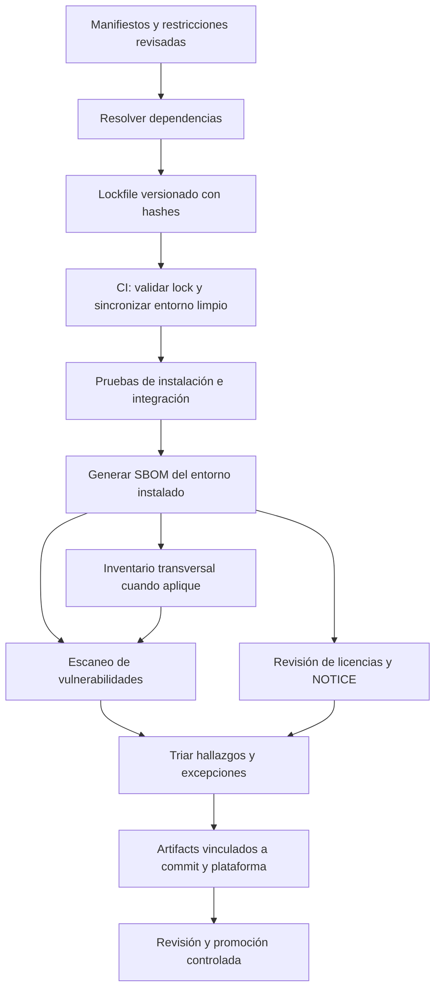

# CPIE — Evaluación de herramientas de cadena de suministro y reproducibilidad

- **Issue:** [#86 — Dependencias reproducibles, SBOM y auditoría](../../issues/86)
- **Estado:** Evaluación documental; ninguna herramienta aprobada ni ejecutada localmente.
- **Fecha de corte:** 2026-11-11
- **Ámbito inicial:** Python 3.12.10 y 3.15.2 en Windows 11 x64; Node.js y contenedores se incorporarán cuando entren en sus POCs.

## 1. Resumen ejecutivo

No existe una herramienta única que resuelva correctamente lockfiles, inventario de componentes, vulnerabilidades y licencias. La propuesta es evaluar herramientas con responsabilidades separadas:

| Capa | Candidato principal | Alternativa/complemento | Función |
|---|---|---|---|
| Resolución y lockfile Python | **uv** | pip-tools / Poetry | Resolver, fijar y sincronizar dependencias Python.
| SBOM Python | **CycloneDX Python (cyclonedx-bom)** | Syft | Inventariar el entorno Python instalado, metadatos, licencias declaradas y grafo.
| SBOM transversal | **Syft** | Generadores específicos | Inspeccionar directorios, filesystem, imágenes y múltiples ecosistemas; SPDX/CycloneDX.
| Vulnerabilidades Python | **pip-audit** | OSV-Scanner | Detectar avisos conocidos en paquetes Python.
| Vulnerabilidades de artefactos | **Grype** | OSV-Scanner | Analizar SBOM, imágenes y otros artefactos soportados.
| Archivos de licencia/copyright | **ScanCode Toolkit** | Revisión manual estructurada | Detectar licencias, copyright y avisos dentro de archivos.

**Recomendación para POC, no adopción:** uv + CycloneDX Python + Syft + pip-audit. Comparar Grype/OSV-Scanner y evaluar ScanCode para completar el análisis de archivos de licencia. No desplegar todos los escáneres por duplicado sin una diferencia de cobertura demostrada.

## 2. Evaluación por herramienta

### 2.1 uv — gestión y lockfiles Python

**Capacidad documentada:** resuelve dependencias de proyecto, mantiene uv.lock y sincroniza entornos. Los modos `--locked` comprueban que el lockfile esté actualizado y fallan si tendría que cambiar; `--frozen` usa el lockfile sin comprobar su actualización.

**Ventajas:** unifica resolución/lock/sync; facilita instalaciones limpias en CI; permite separar dependencias runtime y grupos de desarrollo.

**Riesgos y pruebas necesarias:**
- Verificar soporte en Python 3.12 y 3.15, Windows x64, wheels binarios y paquetes CPU-only.
- Probar si un único lockfile universal representa correctamente las dos lanes o si las restricciones PyTorch/otros paquetes exigen proyectos/lockfiles distintos.
- Verificar hashes, fuentes/índices, dependencias opcionales y comportamiento en instalaciones limpias.
- Un lockfile no es un SBOM, un análisis de vulnerabilidades, una auditoría de licencias ni una prueba de procedencia.
- En CI, usar el modo que comprueba consistencia entre manifiesto y lockfile; no regenerar silenciosamente la resolución.

Fuentes: https://docs.astral.sh/uv/concepts/projects/lock/ ; https://docs.astral.sh/uv/concepts/projects/sync/ ; https://docs.astral.sh/uv/reference/cli/

### 2.2 CycloneDX Python — SBOM del entorno Python

Genera SBOM CycloneDX desde entornos Python virtuales, requirements y ciertos manifiestos/lockfiles. La documentación oficial actual aclara que **uv no está soportado como fuente directa de manifest/lockfile**. Para CPIE, la vía comprobable es sincronizar primero el entorno con `uv sync --locked` y generar el SBOM inspeccionando el intérprete/entorno realmente instalado. El proyecto indica que el análisis del entorno instalado es la opción más precisa y puede incluir metadatos, licencias y grafo de dependencias; permite validar la salida. No debe afirmarse que el SBOM fue generado directamente desde `uv.lock`.

**Pruebas necesarias:** generar un SBOM después de sincronizar desde lockfile, apuntando al ejecutable Python de cada entorno; validar formato y grafo; revisar licencias ausentes/ambiguas; fijar versión del generador; comparar cobertura con Syft. La opción de salida reproducible debe evaluarse y el artefacto debe llevar hash y metadatos de ejecución. El campo de licencia no equivale a una conclusión jurídica.

Comando de referencia a validar en la POC (la sintaxis exacta debe confirmarse con `--help` de la versión fijada):

```powershell
cyclonedx-py environment --output-reproducible --validate --spec-version 1.6 --output-format JSON --output-file .\\poc-results\\python-312.cdx.json <path-to-locked-env-python.exe>
```

El comando usa el entorno instalado como fuente; no interpreta directamente `uv.lock`.

Fuentes: https://github.com/CycloneDX/cyclonedx-python ; https://github.com/CycloneDX/cyclonedx-python/blob/main/docs/usage.rst

### 2.3 Syft — inventario transversal

Genera SBOM desde directorios, sistemas de archivos, archivos e imágenes de contenedor. Soporta múltiples ecosistemas y formatos SPDX, CycloneDX y JSON nativo. Sus catalogadores detectan paquetes declarados e instalados y el SBOM registra qué catalogadores se ejecutaron.

**Pruebas necesarias:** inspeccionar catalogadores usados, comparar paquetes declarados frente a instalados, revisar detección de bibliotecas nativas/OS y evitar duplicar sin criterio el SBOM específico de Python. Un componente no detectado no demuestra que esté ausente.

Fuentes: https://oss.anchore.com/docs/guides/sbom/ ; https://oss.anchore.com/docs/guides/sbom/catalogers/ ; https://oss.anchore.com/docs/reference/syft/cli/

### 2.4 pip-audit — vulnerabilidades Python

Audita entornos, árboles de dependencias y entradas de requisitos; documenta también auditoría de lockfiles para proyectos/formatos soportados. Es adecuado como primera línea para avisos conocidos en paquetes Python.

**Limitaciones explícitas:** no es analizador estático de código; no detecta malware ni garantiza seguridad; las fuentes de avisos pueden no asociar vulnerabilidades de bibliotecas compartidas nativas con el paquete Python que las incorpora. Revisar siempre paquetes omitidos y motivos.

Fuente: https://github.com/pypa/pip-audit

### 2.5 Grype y OSV-Scanner — comparación complementaria

- **Grype:** escáner de vulnerabilidades que consume SBOM y analiza artefactos/imagenes soportados. Útil si CPIE incorpora contenedores o quiere reanalizar un SBOM ya generado. Fuente: https://oss.anchore.com/docs/guides/vulnerability/
- **OSV-Scanner:** usa la base OSV y soporta diversos manifests, lockfiles y SBOM según su documentación. Comparar cobertura real frente a pip-audit/Grype; no adoptar varios escáneres equivalentes sin justificación. Fuente: https://google.github.io/osv-scanner/

### 2.6 ScanCode Toolkit — licencias y copyright

Detecta licencias, copyright y avisos en archivos de código/distribuciones. Complementa metadatos declarados, pero requiere revisar coincidencias, contexto, excepciones y avisos de terceros. No determina automáticamente las obligaciones legales de una distribución ni sustituye asesoría jurídica.

Fuente: https://scancode-toolkit.readthedocs.io/

## 2.7 Snapshot de versiones candidatas — 2026-11-11

Este snapshot registra versiones publicadas observadas en los repositorios oficiales. Es una referencia para diseñar la POC, no una aprobación de adopción ni una instrucción para instalar herramientas sin aislamiento.

| Herramienta | Versión candidata observada | Uso en la POC | Estado |
|---|---:|---|---|
| CycloneDX Python (`cyclonedx-bom`) | 7.6.0 (release 2026-10-28) | SBOM CycloneDX del entorno Python instalado | Candidata; ejecutar y validar en Python 3.12/3.15 |
| Syft | 1.57.1 | SBOM transversal y comparación de cobertura | Candidata; ejecutar y comparar |
| pip-audit | 2.10.1 | Auditoría de advisories Python | Candidata; ejecutar y revisar |
| Grype | No fijada | Escaneo opcional del SBOM | Pendiente de comparar |
| OSV-Scanner | No fijada | Alternativa/complemento de escaneo | Pendiente de comparar |
| ScanCode Toolkit | No fijada | Inspección de archivos LICENSE/NOTICE/copyright | Pendiente de verificar versión y ejecutar |

Fuentes oficiales de versiones:
- CycloneDX Python: https://github.com/CycloneDX/cyclonedx-python/releases
- Syft: https://github.com/anchore/syft/releases
- pip-audit: https://github.com/pypa/pip-audit/releases

El release oficial de CycloneDX Python 7.6.0 está fechado el 2026-10-28. Su CLI soporta generar SBOM desde el entorno instalado; la documentación dice explícitamente que uv manifest/lock no tiene soporte nativo directo. Las versiones de herramientas de seguridad también deben fijarse por versión y, cuando sea posible, hash/procedencia. Registrar fecha de ejecución y fecha/identificador de la base de advisories. Una versión "latest" consultada hoy no debe resolverse dinámicamente en CI: la POC debe probar versiones fijadas y renovarlas mediante revisión explícita.

## 3. Flujo objetivo



El diagrama expresa el proceso objetivo; no representa automatización ya implementada.

## 4. Evidencia mínima por ejecución

Registrar commit SHA, branch/ref, fecha UTC, OS/build/arquitectura, runtime exacto, versiones de herramientas, hash de lockfile y SBOM, comandos/códigos de salida, resultado de instalación limpia y pruebas, inventario de componentes, licencias declaradas/campos desconocidos, advisories/fuente/triage, paquetes omitidos, excepciones con responsable/justificación/vencimiento y limitaciones de catalogación. No incluir secretos, rutas personales ni datos privados.

## 5. Separación de entornos Python

Las POCs ya ejecutadas probaron Python 3.12.10 + PyTorch CPU y workload cuantitativo sintético, y Python 3.15.2 para la matriz general de instalación/importación.

Evaluar dos diseños sin asumir cuál es correcto:
1. Un proyecto/lockfile que modele de forma válida marcadores de plataforma/versión y dependencias opcionales.
2. Manifiestos/lockfiles separados por lane si las restricciones y resoluciones realmente difieren.

No crear lockfiles separados artificialmente. Demostrar resolución y reconstrucción desde cero en Windows x64. La POC debe usar entornos temporales limpios, sin modificar los entornos existentes del usuario ni sus carpetas de resultados.

## 6. Matriz funcional

| Criterio | uv | CycloneDX Python | Syft | pip-audit | Grype | OSV-Scanner | ScanCode |
|---|---|---|---|---|---|---|---|
| Lock/resolución Python | Principal | No | No | No | No | No | No |
| SBOM Python instalado | No | Principal | Complementario | No | Consume SBOM | Consume/analiza según formato | No |
| SBOM multi-ecosistema/OS | No | Limitado a Python | Principal | No | No | No | No |
| Vulnerabilidades conocidas | No | No | No | Principal Python | Principal artefactos | Principal OSV | No |
| Licencias/archivos | No | Metadatos SBOM | Metadatos detectados | No | No | No | Principal archivos |
| Instalación reproducible | Principal | No | No | No | No | No | No |

La tabla describe responsabilidades, no una puntuación de calidad. La puntuación se completará tras ejecutar POCs con versiones exactas y criterios predefinidos.

## 7. POC propuesta

1. Abrir rama experimental sin alterar main.
2. Crear manifiestos mínimos a partir de dependencias directas realmente usadas; no declarar todas las transitivas como directas.
3. Resolver Python 3.12 y 3.15 y guardar lockfiles.
4. Crear entornos vacíos y sincronizar desde lockfiles.
5. Repetir el workload sintético Python 3.12 y smoke tests aplicables Python 3.15.
6. Generar SBOM CycloneDX por entorno y validar formato, licencias y grafo.
7. Ejecutar Syft sobre repositorio y, cuando exista, imagen de contenedor; revisar catalogadores y diferencias.
8. Ejecutar pip-audit y comparar Grype u OSV-Scanner; documentar avisos, paquetes omitidos y discrepancias.
9. Probar regeneración controlada, diff revisable y rollback.
10. Publicar artifacts con hashes y vincular resultados a Issue #86.

## 8. Criterios de selección

Una herramienta se recomienda solo si mantiene releases/documentación, funciona en Windows 11 x64 y runners CI, tiene licencia compatible, permite automatización no interactiva y salida auditable, cubre el ecosistema real, tiene coste/consumo proporcionados, y sus limitaciones/falsos negativos son entendibles. No asignar puntuaciones hasta ejecutar comparación reproducible.

## 9. Estado provisional tras las POCs — 2026-11-11

La evaluación documental se complementa con las siguientes evidencias separadas. Ninguna de ellas constituye aprobación de baseline para producción:

| Capa | Evidencia actual | Estado y límite |
|---|---|---|
| Lockfile Python | [PR #88 — uv universal lock reconstruction](../../pull/88) | `uv.lock` versionado; reconstrucción limpia Windows x64 CPython 3.12/3.15 y workload sintético 3.12 documentados. CI anterior del HEAD completada con éxito. POC experimental, no baseline global. |
| SBOM Python | [PR #90 — CycloneDX SBOM](../../pull/90) | CycloneDX 1.6 generado y validado localmente desde el entorno instalado; dos salidas idénticas por SHA-256. JSON aún sin artifact controlado de CI. Cobertura de paquetes Python, no inventario completo del sistema operativo o notices nativos. |
| SBOM transversal | [PR #91 — Syft comparison](../../pull/91) | Procedimiento diseñado; descarga, verificación Sigstore, ejecución y comparación permanecen pendientes. |
| Vulnerabilidades Python | pip-audit | Versión candidata identificada; ejecución y triage pendientes. |
| Vulnerabilidades de artefactos | Grype / OSV-Scanner | Comparación de cobertura y ejecución pendientes. |
| Licencias y notices | ScanCode + revisión manual | Versión/ejecución pendientes. La revisión puntual de licencias de PR #90 no equivale a un inventario completo de notices. |

### Decisión provisional

- **uv:** candidato respaldado por la POC de reconstrucción, pendiente de evaluación de seguridad, licencias, alcance multiplataforma y decisión de baseline.
- **CycloneDX Python:** candidato respaldado por generación local reproducible; falta retención controlada del SBOM y comparación de cobertura.
- **Syft:** candidato complementario; no recomendar hasta ejecutar la POC y estudiar discrepancias.
- **pip-audit, Grype y OSV-Scanner:** no seleccionar por nombre o popularidad; comparar avisos, cobertura, falsos negativos, fuentes y mantenimiento con versiones fijadas.
- **ScanCode:** candidato para análisis de archivos LICENSE/NOTICE; todavía no ejecutado.

**Estado global:** existe un lockfile experimental y una generación SBOM local reproducible, pero no existe una Validated Baseline aprobada, un inventario integral de componentes, un escaneo de vulnerabilidades completado ni clearance legal.

## 10. Referencias normativas y técnicas

- CycloneDX: https://cyclonedx.org/specification/overview/
- SPDX: https://spdx.dev/specifications/
- NIST SSDF SP 800-218: https://csrc.nist.gov/pubs/sp/800/218/final
- OpenSSF Scorecard: https://scorecard.dev/
- uv: https://docs.astral.sh/uv/
- CycloneDX Python: https://github.com/CycloneDX/cyclonedx-python
- Syft: https://github.com/anchore/syft
- pip-audit: https://github.com/pypa/pip-audit
- Grype: https://github.com/anchore/grype
- OSV-Scanner: https://github.com/google/osv-scanner
- ScanCode Toolkit: https://github.com/aboutcode-org/scancode-toolkit

## 11. Estado

- [x] Revisión documental inicial de capacidades y limitaciones.
- [x] Separación de responsabilidades entre lockfile, SBOM, vulnerabilidades y licencias.
- [x] Candidatos para POC identificados.
- [x] Límite CycloneDX Python/uv documentado: el SBOM se genera desde el entorno instalado, no desde una lectura directa de `uv.lock`.
- [x] Snapshot de versiones candidatas y fecha de release CycloneDX Python 7.6.0 documentados.
- [x] POC de lockfile universal y reconstrucción Windows CPython 3.12/3.15 documentada en PR #88.
- [x] Generación local CycloneDX 1.6 reproducible y revisión estructural/licencias inicial documentadas en PR #90.
- [ ] Retener el SBOM CycloneDX como artifact controlado vinculado a commit y ejecución.
- [ ] Verificar/ejecutar Syft y comparar inventarios por PURL/coordenadas en PR #91.
- [ ] Verificar compatibilidad del generador CycloneDX en Python 3.15 si se requiere esa lane.
- [ ] Ejecutar pip-audit, comparar Grype/OSV-Scanner y hacer triage de advisories.
- [ ] Ejecutar ScanCode y completar revisión de LICENSE/NOTICE, bibliotecas nativas y avisos embebidos.
- [ ] Aprobar herramientas y documentar decisión en ADR-0002/Issue #5.