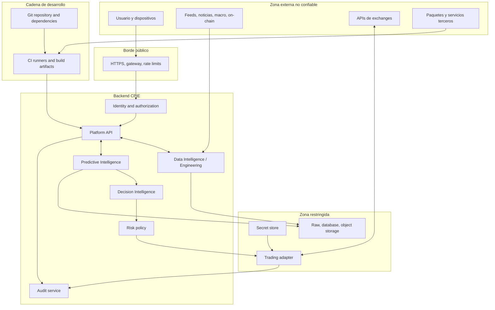

# Modelo de amenazas inicial de CPIE

- **Versión:** 0.1
- **Estado:** Modelo inicial de diseño; requiere revisión al cerrar #5 y antes de implementar controles.
- **Fecha:** 2026-11-10
- **Issues:** #7, #4, #5, #55, #56, #59, #63, #64, #65
- **ADR de arquitectura:** [ADR-0001](../adr/0001-modular-architecture.md)
- **Arquitectura de referencia:** [reference-architecture.md](../architecture/reference-architecture.md)

## 1. Propósito y límites

Identificar activos, actores, límites de confianza, superficies de ataque y escenarios de amenaza para CPIE antes de implementar integraciones y trading. El análisis es de diseño, no una prueba de penetración, auditoría de código ni certificación.

El stack final, el proveedor de identidad, el proveedor de almacenamiento y el entorno de despliegue aún no están seleccionados. Los controles se expresan de forma tecnológica-neutral; deberán concretarse en #5 y en los Issues de implementación.

## 2. Contexto y supuestos

- CPIE será multiactivo; BTC es el piloto inicial.
- Web, Android e iOS consumen un backend/API común.
- Las fuentes de mercado, on-chain, derivados, macro y noticias son externas y no confiables hasta su validación.
- Los datos originales, revisiones, snapshots, features, predicciones y evaluaciones deben ser trazables y reproducibles.
- Modelos y workers de investigación no reciben claves de exchange ni permisos de ejecución.
- Risk & Trading es el único componente autorizado para evaluar y emitir órdenes.
- PAPER es el modo inicial; SHADOW requiere habilitación explícita; LIVE permanece bloqueado.
- No se conoce todavía el proveedor de identidad ni el entorno de producción.
- No se asume que el usuario tenga fondos ni que existan credenciales reales en el repositorio.

## 3. Activos que requieren protección

| ID | Activo | Impacto si se compromete | Confidencialidad | Integridad | Disponibilidad |
|---|---|---|---|---|---|
| A-01 | API keys/secrets de exchanges | Acceso no autorizado a cuenta/operaciones | Crítica | Crítica | Alta |
| A-02 | Credenciales de usuario, sesiones y tokens | Suplantación y acceso a datos/funciones | Alta | Alta | Media |
| A-03 | Órdenes, Order Intent, fills y configuración de riesgo | Operaciones no autorizadas o pérdidas | Alta | Crítica | Crítica |
| A-04 | Datos raw, snapshots, eventos y procedencia | Investigación inválida o manipulación de conclusiones | Variable | Crítica | Alta |
| A-05 | Features, datasets y etiquetas | Leakage, envenenamiento y sesgo de modelos | Alta | Crítica | Alta |
| A-06 | Modelos, pesos, código, parámetros y métricas | Robo, manipulación o degradación de predicciones | Alta | Crítica | Media |
| A-07 | Predicciones, señales y evaluaciones | Decisiones erróneas o exposición de estrategia | Alta | Crítica | Alta |
| A-08 | Código fuente, dependencias, pipelines y artefactos | Compromiso de cadena de suministro | Alta | Crítica | Alta |
| A-09 | Logs, auditoría y evidencias | Pérdida de atribución y detección | Alta | Crítica | Alta |
| A-10 | Backups, claves de cifrado y configuración | Pérdida/exposición sistémica | Crítica | Crítica | Crítica |
| A-11 | Identidad del sistema, roles y políticas | Escalada de privilegios | Crítica | Crítica | Alta |
| A-12 | Datos personales y preferencias | Privacidad y obligaciones legales | Alta | Alta | Media |

## 4. Actores y capacidades

| Actor | Capacidad/objetivo | Confianza |
|---|---|---|
| Usuario legítimo | Consultar, investigar y autorizar operaciones según permisos | Identidad autenticada, no confianza implícita |
| Atacante externo | Abusar API, robar sesiones, manipular solicitudes o provocar indisponibilidad | No confiable |
| Cuenta comprometida | Usar privilegios legítimos para exfiltrar datos o intentar operar | No confiable |
| Fuente/proveedor externo | Entregar datos erróneos, manipulados, tardíos o maliciosos, accidental o intencionalmente | No confiable |
| Exchange | Responder con estados incompletos, tardíos, inconsistentes o rechazos; también puede sufrir incidentes | Dependencia externa |
| Dependencia/software de terceros | Introducir vulnerabilidad o código malicioso | No confiable hasta verificar |
| Pipeline/runner comprometido | Exfiltrar secretos o modificar artefactos y releases | Alta criticidad |
| Insider/administrador | Abusar permisos o cometer errores con privilegios elevados | Confianza limitada y auditable |
| Agente/modelo de IA | Producir salidas incorrectas, manipular contenido o sugerir acciones | No autoridad; salida no confiable |

## 5. Límites de confianza

El diagrama expresa zonas y flujos lógicos. No implica que los componentes o servicios estén desplegados.

## 6. Superficies de ataque

1. Web, app Android/iOS, endpoints API, autenticación, recuperación de cuenta y gestión de sesiones.
2. Entrada de datos externos: parsers, archivos, feeds, webhooks, URLs y metadatos.
3. Adaptadores de exchange: autenticación, permisos, firmas, rate limits, órdenes y reconciliación.
4. Procesamiento de datasets: serialización, formatos columnar, archivos comprimidos y metadatos.
5. Entrenamiento/inferencia: dependencias, artefactos de modelo, código de plugins y datos de entrenamiento.
6. Almacenamiento: base transaccional, object storage, backups, snapshots y logs.
7. CI/CD: tokens, runners, workflows, artefactos, dependencias y permisos de GitHub.
8. Configuración local y contenedores: variables de entorno, volúmenes, puertos, imágenes y secretos.
9. Canales de administración: cambios de riesgo, configuración de exchanges, habilitación de modos y políticas.

## 7. Escenarios de amenaza y controles

La prioridad es cualitativa y preliminar: P0 indica que el control debe existir antes de habilitar la capacidad afectada; P1 antes de producción; P2 durante maduración. No representa probabilidad estadística.

| ID | Escenario / STRIDE | Impacto | Prioridad | Controles de diseño y mitigación | Issue de implementación |
|---|---|---|---|---|---|
| T-01 | Robo de API key de exchange (Information Disclosure / Elevation) | Operaciones no autorizadas y posible pérdida de fondos | P0 antes de trading | Secret store; claves sin retiro; mínimo privilegio; credencial por entorno; nunca en cliente, modelo, repo o logs; rotación/revocación; allowlist IP si exchange lo soporta | #47–#50, #57–#59 |
| T-02 | Modelo o worker invoca directamente una API de trading (Elevation / Tampering) | Elusión de controles y ejecución | P0 | Sin secretos ni SDK de exchange en Predictive Intelligence; interfaz de decisión no ejecutable; adaptador aislado; política de riesgo independiente; permisos de proceso separados | #7, #47–#50 |
| T-03 | Repetición, duplicación o alteración de órdenes (Tampering / Repudiation) | Duplicación de operaciones, cantidades o estados incorrectos | P0 | Idempotency key; expiración de intent; validación server-side; estados de orden explícitos; correlación; reconciliación con exchange; protección contra replay | #48–#50 |
| T-04 | Manipulación, poisoning o feed falso (Tampering) | Dataset y predicción corruptos | P0 para datos críticos | Procedencia, fuentes independientes cuando aplique, validación de esquema/rangos, detección de anomalías, cuarentena, snapshots raw inmutables, revisión de revisiones y calidad | #8–#28, #64 |
| T-05 | Timestamp incorrecto, dato retrospectivo o look-ahead leakage (Tampering) | Backtest/predicción inválida | P0 | event_time/available_at/ingested_at/recorded_at; point-in-time joins; versionado; pruebas de leakage; conservar fecha de publicación y revisiones | #8–#28, #29–#43 |
| T-06 | Prompt injection o contenido malicioso en noticias/documentos (Spoofing / Tampering) | Manipulación de análisis automatizado o extracción de secretos | P1 | Tratar texto externo como dato, no instrucciones; extracción estructurada; aislamiento de herramientas; no permitir que contenido determine órdenes; validar citas/procedencia | #18–#28, #29–#43 |
| T-07 | BOLA/IDOR, función o propiedad API sin autorización (Elevation / Disclosure) | Acceso a datos/operaciones ajenas | P0 antes de exponer API | Autorización por objeto, propiedad y función; deny-by-default; pruebas negativas multiusuario; no confiar en IDs enviados por cliente | #51–#52 |
| T-08 | Robo de sesión, token o recuperación débil (Spoofing) | Suplantación de usuario | P0 antes de exponer API | Proveedor de identidad evaluado; MFA para operaciones privilegiadas; tokens cortos, rotación/revocación; almacenamiento seguro en móvil; protección CSRF/XSS según cliente | #51–#52 |
| T-09 | SSRF/unsafe URL fetching desde conectores (Tampering / Elevation) | Acceso a metadata endpoints o redes internas | P1 | Allowlist de dominios; bloquear IP privadas/link-local y redirects peligrosos; DNS rebinding defenses; egress control; timeouts y límites de respuesta | #8–#28 |
| T-10 | DoS y agotamiento de recursos (Denial of Service) | Indisponibilidad/coste excesivo | P1 | Rate limits por usuario/endpoint; límites de payload, filas, tiempo y concurrencia; cuotas de jobs; cancelación; backpressure; circuit breakers | #51–#56 |
| T-11 | Dependencia comprometida o typosquatting (Tampering / Elevation) | Ejecución de código en backend/CI | P0 antes de releases | Lockfiles; versiones fijadas; hashes cuando proceda; SBOM; revisión de dependencias; alertas; permisos mínimos; builds reproducibles | #53–#55 |
| T-12 | CI token/runner exfiltra secretos o modifica artefactos (Elevation / Tampering) | Compromiso de releases y credenciales | P0 antes de CI con secretos | Permisos read-only por defecto; OIDC/credenciales efímeras cuando sea posible; secretos por entorno; no ejecutar código no confiable con secretos; proteger runners y artifacts | #53–#55, #68 |
| T-13 | Manipulación de límites de riesgo/configuración (Tampering / Elevation) | Exposición superior a la autorizada | P0 antes de trading | Separar rol de administración; límites versionados y auditados; doble control cuando sea viable; modelo no modifica límites; validación de límites en backend | #44–#50 |
| T-14 | Fill parcial, desconexión o respuesta ambigua de exchange (Denial / Tampering) | Estado interno diverge del exchange | P0 antes de trading | Reconciliación; estados idempotentes; consulta de órdenes abiertas; retry con backoff; no asumir éxito por timeout; kill switch en inconsistencia | #48–#50 |
| T-15 | Robo o sustitución de modelo/artefacto (Tampering / Disclosure) | Predicciones alteradas o estrategia expuesta | P1 | Hashes y procedencia; control de acceso; versionado inmutable; firma/verificación de artefactos cuando proceda; evaluación antes de promoción | #29–#43, #63 |
| T-16 | Exfiltración o modificación de logs/auditoría (Repudiation / Tampering) | Incapacidad de reconstruir incidentes | P1 | Logs estructurados; acceso restringido; integridad y retención; reloj sincronizado; no registrar secretos; correlación de actor, decisión y orden | #53–#56 |
| T-17 | Backup cifrado/roto/inaccesible (Denial / Disclosure) | Pérdida o exposición de datos | P1 | Cifrado en tránsito/reposo; separación de claves; backup aislado; pruebas periódicas de restore; permisos mínimos | #56, #64 |
| T-18 | Datos personales expuestos en logs/exports (Disclosure) | Daño de privacidad y obligaciones legales | P1 | Minimización; clasificación; redacción; retención justificada; controles de acceso; proceso de incidente y borrado aplicable | #51–#56, #65 |
| T-19 | Abuso de APIs sensibles (ordenes, cambios de límites, backfills) (Elevation / DoS) | Operaciones abusivas y costes | P0 antes de trading | Autorización por función; step-up auth; límites de frecuencia y cuantía; confirmación explícita; registro y alertas; LIVE bloqueado | #47–#59 |
| T-20 | Compromiso de dispositivo móvil (Spoofing / Disclosure) | Robo de sesión y exposición local | P1 | No almacenar secretos de exchange; secure storage del SO; protección de tokens; no confiar en controles UI; detección de integridad como señal auxiliar, no control único | #51–#52 |

## 8. Requisitos transversales de seguridad

### Identidad y autorización
- Denegar por defecto y conceder permisos por función, recurso y entorno.
- Separar usuario, administrador, operador y servicios.
- Aplicar MFA/step-up para acciones de alto impacto cuando el proveedor lo permita.
- Revocar sesiones y credenciales comprometidas.
- Validar autorización en backend; la UI no es una frontera de seguridad.

### Secretos
- Secretos solo en almacén/gestor adecuado al entorno; no en código, Git, imágenes, cliente móvil, modelos ni logs.
- Credenciales de exchange separadas por entorno y por finalidad; sin permisos de retiro.
- Acceso por identidad de proceso y mínimo privilegio.
- Registrar metadatos de ciclo de vida, consumidor y propósito; rotar y revocar.
- Procedimiento de incidente para revocación inmediata y análisis de exposición.

### Datos y modelos
- Validar procedencia, esquema, unidad, precisión, cobertura, timestamps y licencias.
- Conservar raw original y transformaciones versionadas.
- Separar dataset disponible en el instante de predicción del dato conocido retrospectivamente.
- Modelos y artefactos inmutables/versionados; promoción condicionada a validación.
- No aceptar instrucciones de contenido externo como instrucciones operativas.
- Modelos no modifican límites ni ejecutan órdenes.

### API y clientes
- TLS; autenticación y autorización en backend.
- Validación estricta de inputs y outputs; límites de payload, paginación y concurrencia.
- Rate limiting y protección de flujos sensibles.
- Gestión segura de sesión en web/móvil; no persistir credenciales de exchange en clientes.
- Versionado, inventario y retirada de endpoints.

### CI/CD y cadena de suministro
- Permisos mínimos en workflows y tokens.
- No exponer secretos a workflows de forks o código no confiable.
- Lockfiles, SBOM, revisión de licencias y análisis de vulnerabilidades.
- Artefactos de build con procedencia; separación de entornos.
- Checks obligatorios solo después de existir y ser estables.

### Operación y respuesta
- Logs sin secretos y con correlación de solicitudes, predicciones, decisiones y órdenes.
- Alertas para cambios de permisos, claves, riesgo, modos y actividad anómala.
- Runbooks de revocación, aislamiento, rollback y recuperación.
- Backups y restauración probados.
- Kill switch que no dependa del modelo ni de la interfaz de usuario.

## 9. Prioridades de implementación y trazabilidad

| Prioridad | Controles | Bloquean |
|---|---|---|
| P0 — antes de exponer API | Autenticación, autorización por objeto/función, validación, TLS, límites de recursos, secretos fuera del cliente | API pública y cuentas |
| P0 — antes de conectar exchange | Separación de secretos/modelos, permisos mínimos, sin retiro, idempotencia, reconciliación, límites, kill switch, PAPER/SHADOW | Cualquier operación con exchange |
| P0 — antes de confiar en predicciones | Procedencia, snapshots, point-in-time, validación de datos, control de artefactos y leakage | Decisiones automatizadas |
| P0 — antes de CI con secretos | Permisos mínimos, protección de runners, separación de workflows no confiables | Releases y secretos |
| P1 — antes de producción | MFA/step-up, monitorización, alertas, backup/restore, respuesta a incidentes, SBOM y análisis de dependencias | Producción |
| P2 — madurez | Automatización avanzada de rotación, aislamiento adicional, detección de anomalías y ejercicios periódicos | Escala/operación madura |

## 10. Riesgos residuales y decisiones pendientes

- Proveedor de identidad y modelo de roles: pendiente de #5 y requisitos.
- Gestor de secretos y KMS: pendiente de entorno de despliegue.
- Amenazas específicas del proveedor de exchange: requieren adaptador y contrato concretos.
- Seguridad móvil y almacenamiento local: requiere POC en dispositivos reales.
- Controles de ML específicos: evolucionar con el pipeline y el modelo de amenazas de datos/modelos.
- Cumplimiento por jurisdicción y obligaciones de trading: #65; este documento no constituye asesoría legal.
- Probabilidad e impacto cuantitativos: no estimados por falta de datos; las prioridades son cualitativas.

## 11. Referencias

- OWASP API Security Top 10 2023: https://owasp.org/www-project-api-security/
- OWASP Secrets Management Cheat Sheet: https://cheatsheetseries.owasp.org/cheatsheets/Secrets_Management_Cheat_Sheet.html
- OWASP Machine Learning Security Top 10 (proyecto en draft): https://owasp.github.io/www-project-machine-learning-security-top-10/
- NIST SP 800-218 SSDF v1.1: https://csrc.nist.gov/pubs/sp/800/218/final

OWASP ML Security Top 10 está en estado draft según su propia página; se usa como catálogo de amenazas emergentes, no como estándar normativo ni como criterio de conformidad.

## 12. Estado de implementación

Este documento es un threat model inicial. No demuestra que controles estén implementados o probados. Cada control deberá traducirse en requisito, Issue, implementación, prueba y evidencia antes de marcarlo como verificado.
